# rd-governor — 参考文件索引与知识图谱

> 本技能包含 4 个参考文件集，共 115 个文件（`book-rd-deduction-hightech/` 10、`book-ipo-rd-guide/` 22、`policy-docs/` 49、`templates/` 34），另含企业实践索引 1 个，合计 116 个文件；`policy-docs/` 目录内另有 32 个尚未转换为 markdown 的 doc/docx/pdf/图片文件；内容块级索引见 4 个 MOC 文件。
> 遵循 skill-pattern Skill Graph 模式：渐进式揭示（MOC 按需加载）+ 语义化链接（关联网络嵌入论述语境）。
>
> **内容块索引 MOC**（按需加载，不要一开始就读）：
> - [moc-book-rd-deduction-hightech.md](./references/moc-book-rd-deduction-hightech.md) — 第一本书10个文件的内容块索引
> - [moc-book-ipo-rd-guide.md](./references/moc-book-ipo-rd-guide.md) — IPO指引22个文件的内容块索引
> - [moc-policy-docs.md](./references/moc-policy-docs.md) — 49个政策文件（含稽查案例汇编及其违规类型映射、生物医药与家电制造业行业指引）的内容块索引
> - [moc-templates.md](./references/moc-templates.md) — 34个模板文件的内容块索引

## 参考文件集概览

| 文件集 | 来源 | 文件数 | 路径 | 说明 |
|--------|------|--------|------|------|
| 《研发费用加计扣除与高新技术企业优惠实务及案例》 | 2024年3月版 | 10 | `book-rd-deduction-hightech/` | 部分内容已被2024-2026政策更新覆盖 |
| 《企业IPO研发费用规范指引》 | 天职国际，2023年11月 | 22 | `book-ipo-rd-guide/` | 按章节二级标题拆分，四段式结构 |
| 政策原文文件 | 财政部/税务总局/证监会/人大/广东注协/广东税务局 | 49 | `policy-docs/` | 会计准则、税务法规、证监会指引、实施问答、鉴定案例、稽查案例及其违规类型映射、行业专项指引 |
| 企业实践索引 | 技能内置 | 1 | `enterprise-practice-index.md` | 长正资料企业实际文件实践（辅助账/流转表/分配表/台账） |
| 模板文件 | 技能内置 | 34 | `templates/`（4子目录） | 制度16个/流程7个/表单6个/实操工具5个 |

---

## 参考文件列表（按主题分组）

### 主题一：加计扣除政策与费用归集

| 文件 | 章节 | 核心内容 |
|------|------|----------|
| `book-rd-deduction-hightech/rd-deduction-overview.md` | 第一章 | 政策沿革、研发活动界定、不适用活动负面清单 |
| `book-rd-deduction-hightech/rd-deduction-benefits.md` | 第二章 | 6类费用归集、10%限额、冲减情形、三口径差异 |
| `book-rd-deduction-hightech/rd-deduction-filing-risk.md` | 第五章 | 预缴三次时点、A107012表、留存备查资料 |
| `book-rd-deduction-hightech/case-studies.md` | 案例汇编 | 7个实操案例（鉴定/委外/辅助账/申报/口径混用等） |
| `book-rd-deduction-hightech/policy-updates-2024-2026.md` | 政策更新 | 2024-2026年政策变化、各章时效性评估 |

### 主题二：高新技术企业认定与优惠

| 文件 | 章节 | 核心内容 |
|------|------|----------|
| `book-rd-deduction-hightech/hightech-tax-benefits.md` | 第六章 | 15%税率优惠、有效期、复核处理 |
| `book-rd-deduction-hightech/hightech-certification-conditions.md` | 第七章 | 8项认定条件、知识产权I/II类、研发费用占比 |
| `book-rd-deduction-hightech/hightech-supervision-risk.md` | 第八章 | 认定程序、抽查、年报、资格取消 |

### 主题三：IPO研发投入监管与财务处理

| 文件 | 章节 | 核心内容 |
|------|------|----------|
| `book-rd-deduction-hightech/ipo-rd-supervision.md` | 第三章 | 证监会监管要求、保荐机构核查10项、R&D统计 |
| `book-rd-deduction-hightech/rd-financial-control.md` | 第四章 | 费用化/资本化、2021版辅助账、6阶段风险管控 |

### 主题四：IPO研发费用规范指引（22个拆分文件）

#### 4.1 研发活动与投入界定（第二章）

| 文件 | 核心内容 |
|------|----------|
| `book-ipo-rd-guide/ipo-rd-overview.md` | 上市公司研发投入统计、IPO问询关注事项 |
| `book-ipo-rd-guide/ipo-rd-activity-definition.md` | 研发活动三要素、研发与生产边界 |
| `book-ipo-rd-guide/ipo-rd-investment-definition.md` | 研发投入构成、费用与成本划分 |
| `book-ipo-rd-guide/ipo-rd-business-relevance.md` | 研发活动与主营业务关联性 |

#### 4.2 研发内控管理（第三章）

| 文件 | 核心内容 |
|------|----------|
| `book-ipo-rd-guide/ipo-internal-control-system.md` | 内控制度健全性 |
| `book-ipo-rd-guide/ipo-rd-organization.md` | 研发组织架构、岗位设置 |
| `book-ipo-rd-guide/ipo-rd-budget-management.md` | 预算编制/审批/执行/调整 |
| `book-ipo-rd-guide/ipo-rd-project-initiation.md` | 立项审批流程 |
| `book-ipo-rd-guide/ipo-rd-implementation-management.md` | 人员/物料/资产/委外/过程管理（38KB） |
| `book-ipo-rd-guide/ipo-rd-acceptance-archive.md` | 验收结项、资料归档 |

#### 4.3 研发支出会计核算（第四章）

| 文件 | 核心内容 |
|------|----------|
| `book-ipo-rd-guide/ipo-accounting-materials.md` | 研发领料、样品、废料 |
| `book-ipo-rd-guide/ipo-accounting-labor.md` | 研发人工、工时、股份支付 |
| `book-ipo-rd-guide/ipo-accounting-depreciation.md` | 折旧与摊销 |
| `book-ipo-rd-guide/ipo-accounting-cooperative-rd.md` | 合作研发 |
| `book-ipo-rd-guide/ipo-accounting-outsourced-rd.md` | 委托研发 |
| `book-ipo-rd-guide/ipo-accounting-mold.md` | 研发模具 |
| `book-ipo-rd-guide/ipo-accounting-prototype.md` | 研发样机 |
| `book-ipo-rd-guide/ipo-accounting-cost-allocation.md` | 费用与成本划分 |
| `book-ipo-rd-guide/ipo-accounting-capitalization.md` | 资本化条件、5个行业参考（25KB） |

#### 4.4 研发税务与披露（第五~六章）

| 文件 | 核心内容 |
|------|----------|
| `book-ipo-rd-guide/ipo-tax-rules.md` | 三口径对比、扣除比例、备查资料 |
| `book-ipo-rd-guide/ipo-tax-issues-verification.md` | 税务典型问题、核查重点 |
| `book-ipo-rd-guide/ipo-rd-disclosure.md` | 招股说明书研发信息披露 |

### 主题零：企业实践参考（AL编号体系）

| 文件 | 参考来源 | 核心内容 |
|------|---------|---------|
| `enterprise-practice-index.md` | 长正资料（企业实际文件） | 辅助账/项目流转表/分配表/人员台账/台账底稿的企业实践模式，覆盖23项实操工具模板 |
### 主题五：政策原文文件

| 文件 | 来源 | 行数 |
|------|------|------|
| `policy-docs/研发费用加计扣除政策执行指引2.0.md` | 税务总局官方 | 470 |
| `policy-docs/高新技术企业认定管理办法-国科发火2016-32号.md` | 国科发火〔2016〕32号 | 1057 |
| `policy-docs/高新技术企业认定管理工作指引-国科发火2016-195号.md` | 国科发火〔2016〕195号 | 615 |
| `policy-docs/企业IPO研发费用规范指引.md` | 天职国际 | 1405 |
| `policy-docs/粤注协2022-191号高企认定专项审计风险提示函.md` | 广东省注册会计师协会 | 52 |

#### 加计扣除政策法规原文（11 个）

| 文件 | 文号 | 时效状态 | 行数 |
|------|------|----------|------|
| `policy-docs/财税2015-119号-完善研究开发费用税前加计扣除政策.md` | 财税〔2015〕119号 | ⚠️部分失效（委托境外条款失效） | 80 |
| `policy-docs/税务总局公告2015-97号-研发费用加计扣除政策有关问题.md` | 税务总局公告2015年第97号 | ⚠️部分失效（多条被40号公告废止） | 86 |
| `policy-docs/税务总局公告2017-40号-研发费用加计扣除归集范围.md` | 税务总局公告2017年第40号 | ✅现行有效 | 56 |
| `policy-docs/税总发2017-106号-加强研发费用加计扣除政策贯彻落实.md` | 税总发〔2017〕106号 | ✅现行有效 | 30 |
| `policy-docs/国科发政2017-115号-科技型中小企业评价办法.md` | 国科发政〔2017〕115号 | ✅现行有效 | 105 |
| `policy-docs/财税2018-64号-委托境外研发费用加计扣除.md` | 财税〔2018〕64号 | ✅现行有效 | 41 |
| `policy-docs/税务总局公告2018-23号-企业所得税优惠政策事项办理办法.md` | 税务总局公告2018年第23号 | ✅现行有效 | 45 |
| `policy-docs/税务总局公告2021-28号-进一步落实研发费用加计扣除政策.md` | 税务总局公告2021年第28号 | ✅现行有效 | 46 |
| `policy-docs/财政部税务总局公告2023-7号-进一步完善研发费用加计扣除政策.md` | 财政部 税务总局公告2023年第7号 | ✅现行有效 | 27 |
| `policy-docs/税务总局财政部公告2023-11号-优化预缴申报享受研发费用加计扣除.md` | 税务总局 财政部公告2023年第11号 | ✅现行有效 | 30 |
| `policy-docs/财政部等四部门公告2023-44号-集成电路工业母机企业120%加计扣除.md` | 财政部等四部门公告2023年第44号 | ✅现行有效（至2027-12-31） | 38 |

> **以下文号已废止/被替代，引用政策时不得使用（14 个）**: 国税发〔1996〕152号、财税〔2003〕244号、国税发〔2004〕82号、国科发政字〔2000〕63号、财税〔2006〕88号、国税发〔2008〕116号、财税〔2013〕70号、财税〔2017〕34号、税务总局公告2017年第18号、财税〔2018〕99号、财政部税务总局公告2021年第13号、财政部税务总局科技部公告2022年第16号、财政部税务总局科技部公告2022年第28号（全文废止2023-01-01）、税务总局公告2022年第10号

#### 会计准则与证监会指引（4 个）

| 文件 | 来源 | 时效状态 | 行数 |
|------|------|----------|------|
| `policy-docs/企业会计准则第6号-无形资产.md` | 财政部会计准则委员会（财会〔2006〕3号） | ✅现行有效 | 118 |
| `policy-docs/企业会计准则解释第15号-财会2021-35号.md` | 财政部（财会〔2021〕35号） | ✅现行有效 | 66 |
| `policy-docs/监管规则适用指引-发行类第9号-研发人员及研发投入.md` | 中国证监会（2023年11月24日） | ✅现行有效 | 488 |
| `policy-docs/财政部会计司2025年4月17日实施问答.md` | 财政部会计司（2025年4月17日） | ✅现行有效 | 40 |

#### 法律基础/鉴定案例/年报通知/科创属性/审计实务（6 个）

| 文件 | 来源 | 时效状态 | 行数 |
|------|------|----------|------|
| `policy-docs/企业所得税法及实施条例-研发费用加计扣除条款.md` | 全国人大/国务院 | ✅现行有效 | 24 |
| `policy-docs/研发费用加计扣除项目鉴定案例-第三辑.md` | 科技部二司+税务总局所得税司，2026年1月 | ✅现行有效 | 161 |
| `policy-docs/财会2025-33号-严格执行企业会计准则做好2025年年报工作.md` | 财政部（财会〔2025〕33号） | ✅现行有效 | 311 |
| `policy-docs/科创属性评价指引-试行-证监会2024年修改.md` | 证监会公告〔2024〕6号 | ✅现行有效 | 64 |
| `policy-docs/粤注协2025-199号-研发活动识别与研发费用分类问题解答.md` | 广东注协（粤注协〔2025〕199号） | ✅现行有效 | 259 |
| `policy-docs/粤注协2026第1期-高企认定专项审计实务问题答疑.md` | 广东注协，2026年5月11日 | ✅现行有效 | 39 |

#### 稽查案例与广东省税务局行业指引（3 个）

| 文件 | 来源 | 时效状态 | 行数 |
|------|------|----------|------|
| `policy-docs/研发费用税务稽查案例汇编-11个案例.md` | 税务机关公开的税务行政处罚决定书、告知书（11个），每案附违规要点→政策条款映射 | ✅现行有效 | 419 |
| `policy-docs/生物医药领域企业研发费税收政策指引-广东省税务局.md` | 广东省税务局（2020年5月1.0版） | ⚠️部分失效（比例/预缴/备案/辅助账已更新） | 951 |
| `policy-docs/家电制造业研发费用加计扣除政策执行指引-广东省税务局.md` | 广东省税务局、广东省科学技术厅（2022年8月） | ⚠️部分失效（75%比例/预缴时点/2021年第13号已更新） | 2335 |

---

### 主题六：模板文件

| 文件 | 用途 | 行数 |
|------|------|------|
| `01-regulations/internal-control-system.md` | 研发费用内控制度 9 章骨架 | 58 |
| `01-regulations/mold-management-system.md` | 研发模具管理制度 9 章 | 91 |
| `01-regulations/budget-management-system.md` | 研发费用预算管理制度 | -- |
| `01-regulations/super-deduction-management-system.md` | 加计扣除专项申报管理制度 | -- |
| `01-regulations/project-archive-management-system.md` | 研发项目档案管理制度 | -- |
| `01-regulations/results-management-system.md` | 研发成果管理制度（含专利管理） | -- |
| `01-regulations/personnel-performance-system.md` | 研发人员绩效考核制度 | -- |
| `01-regulations/travel-meeting-expense-system.md` | 研发差旅费及会议费管理制度 | -- |
| `01-regulations/equipment-management-system.md` | 研发设备管理制度 10 章 | 89 |
| `01-regulations/material-management-system.md` | 研发物料管理制度 9 章 | 90 |
| `01-regulations/workhour-management-system.md` | 研发工时管理制度 8 章 | 82 |
| `01-regulations/personnel-management-system.md` | 研发人员管理制度 10 章 | 95 |
| `01-regulations/project-initiation-management.md` | 研发项目立项管理办法 8 章 | 90 |
| `01-regulations/project-acceptance-management.md` | 研发项目验收结项管理办法 8 章 | 85 |
| `01-regulations/sample-management-system.md` | 竞品与样品样机管理制度 8 章 | 68 |
| `01-regulations/cooperation-patent-management.md` | 产学研合作与知识产权管理制度 | 110 |
| `02-processes/rd-process.md` | 研发流程阶段节点控制表 | 30 |
| `02-processes/daily-management-spec.md` | 日常管理规范 | 43 |
| `02-processes/super-deduction-workflow.md` | 加计扣除申报操作流程（6阶段） | -- |
| `02-processes/expense-reimbursement-workflow.md` | 研发费用报销审批流程 | -- |
| `02-processes/personnel-identification-workflow.md` | 研发人员认定与变更流程 | -- |
| `02-processes/equipment-audit-workflows.md` | 设备共用分摊流程 + 外部核查应对流程 | -- |
| `02-processes/budget-adjustment-and-cross-period-workflows.md` | 预算编制调整流程 + 费用跨期调整流程 | -- |
| `03-forms/forms.md` | 8 个基础表单 | 50 |
| `03-forms/forms-supplement.md` | 10 个补充表单 | -- |
| `03-forms/reports.md` | 4 张报表（归集/加计/高企/IPO） | 48 |
| `03-forms/evidence-checklist.md` | 三套资料证据清单 | 43 |
| `03-forms/labor-cost-allocation.md` | 人工费用分配算法+表格 | 56 |
| `03-forms/expense-difference-explanation.md` | 加计扣除/高企/会计核算口径差异说明 | -- |
| `04-practical-tools/AL-01-auxiliary-ledger-templates.md` | 辅助账模板集（AL-01~04） | -- |
| `04-practical-tools/AL-05-project-flow-table.md` | 研发项目流转表（AL-05~06） | -- |
| `04-practical-tools/AL-07-allocation-tables.md` | 分配表模板集（AL-07~11） | -- |
| `04-practical-tools/AL-12-personnel-ledger.md` | 研发人员台账模板（AL-12~14） | -- |
| `04-practical-tools/AL-15-ledger-working-papers.md` | 台账底稿与凭证序时簿（AL-15~17） | -- |

---

## 知识图谱（Mermaid 依赖图）

```mermaid
graph TD
    subgraph 加计扣除政策与费用归集
        A1[rd-deduction-overview<br/>政策沿革与研发活动界定]
        A2[rd-deduction-benefits<br/>6类费用归集与三口径]
        A3[rd-deduction-filing-risk<br/>申报与备查]
        A4[case-studies<br/>7个实操案例]
        A5[policy-updates-2024-2026<br/>时效性检查]
    end

    subgraph 高企认定与优惠
        B1[hightech-certification-conditions<br/>8项认定条件]
        B2[hightech-tax-benefits<br/>15%税率优惠]
        B3[hightech-supervision-risk<br/>认定程序与监管]
    end

    subgraph IPO监管与财务处理
        C1[ipo-rd-supervision<br/>证监会监管要求]
        C2[rd-financial-control<br/>辅助账与风险管控]
    end

    subgraph IPO指引-研发活动界定
        D1[ipo-rd-activity-definition<br/>研发活动三要素]
        D2[ipo-rd-investment-definition<br/>研发投入构成]
        D3[ipo-rd-business-relevance<br/>业务关联性]
        D0[ipo-rd-overview<br/>IPO研发概况]
    end

    subgraph IPO指引-内控管理
        E1[ipo-internal-control-system<br/>内控制度]
        E2[ipo-rd-organization<br/>组织架构]
        E3[ipo-rd-budget-management<br/>预算管理]
        E4[ipo-rd-project-initiation<br/>立项管理]
        E5[ipo-rd-implementation-management<br/>实施管理]
        E6[ipo-rd-acceptance-archive<br/>验收归档]
    end

    subgraph IPO指引-会计核算
        F1[ipo-accounting-materials<br/>研发领料]
        F2[ipo-accounting-labor<br/>研发人工]
        F3[ipo-accounting-depreciation<br/>折旧摊销]
        F4[ipo-accounting-cooperative-rd<br/>合作研发]
        F5[ipo-accounting-outsourced-rd<br/>委托研发]
        F6[ipo-accounting-mold<br/>模具]
        F7[ipo-accounting-prototype<br/>样机]
        F8[ipo-accounting-cost-allocation<br/>费用划分]
        F9[ipo-accounting-capitalization<br/>资本化]
    end

    subgraph IPO指引-税务与披露
        G1[ipo-tax-rules<br/>三口径与扣除比例]
        G2[ipo-tax-issues-verification<br/>典型问题与核查]
        G3[ipo-rd-disclosure<br/>信息披露]
    end

    subgraph 政策原文
        P1[执行指引2.0<br/>税务总局]
        P2[认定管理办法32号<br/>国科发火]
        P3[认定工作指引195号<br/>国科发火]
        P4[IPO指引完整原文<br/>天职国际]
        P5[粤注协191号<br/>审计风险提示]
        P6[财税2015-119号<br/>加计扣除基础法规]
        P7[税务总局公告2017-40号<br/>归集范围细则]
        P8[财税2018-64号<br/>委托境外研发]
        P9[公告2023-7号<br/>全行业100%]
        P10[公告2023-11号<br/>预缴三次时点]
        P11[公告2023-44号<br/>集成电路120%]
        P12[准则第6号<br/>无形资产]
        P13[解释第15号<br/>试运行销售]
        P14[发行类第9号<br/>研发人员及研发投入]
        P15[2025年实施问答<br/>研发样机费用化]
        P16[企业所得税法<br/>加计扣除法律依据]
        P17[鉴定案例第三辑<br/>研发活动鉴定]
        P18[财会2025-33号<br/>2025年年报准则]
        P19[科创属性指引<br/>科创板4项指标]
        P20[粤注协199号<br/>研发活动识别审计]
        P21[粤注协2026第1期<br/>高企认定审计答疑]
        P22[公告2015-97号<br/>加计扣除操作细则]
        P23[税总发2017-106号<br/>政策落实通知]
        P24[国科发政2017-115号<br/>科技型中小企业]
        P25[公告2018-23号<br/>优惠办理办法]
        P26[公告2021-28号<br/>进一步落实加计]
        P27[稽查案例汇编<br/>11个案例含违规类型映射]
        P28[生物医药指引<br/>行业专项⚠️部分失效]
        P29[家电制造业指引<br/>全流程⚠️比例失效]
    end

    %% depends-on
    A1 -->|depends-on| A2
    A2 -->|depends-on| A3
    B1 -->|depends-on| A1
    F9 -->|depends-on| C2
    G1 -->|depends-on| A2
    E5 -->|depends-on| E1
    F1 -->|depends-on| D1
    F2 -->|depends-on| D1
    F3 -->|depends-on| D1
    F9 -->|depends-on| D1
    P3 -->|depends-on| P2
    P7 -->|depends-on| P6
    P9 ===>|composes-with| P10
    P11 ===>|composes-with| P9
    P13 -->|depends-on| P12
    P15 -->|depends-on| P12
    P15 -->|depends-on| P13
    P14 ===>|composes-with| F2
    P14 -.->|contrasts-with| A2
    P16 -->|depends-on| P6
    P17 -->|depends-on| P6
    P18 -->|depends-on| P12
    P20 -->|depends-on| P1
    P21 -->|depends-on| P13
    P16 ===>|composes-with| P9
    P17 ===>|composes-with| P1
    P20 ===>|composes-with| P21
    P19 ===>|composes-with| D0
    P19 -.->|contrasts-with| P2
    P18 -.->|contrasts-with| P15
    P27 ===>|composes-with| P6
    P27 ===>|composes-with| P7
    P27 ===>|composes-with| P14
    P27 -.->|contrasts-with| P17
    P28 ===>|composes-with| P6
    P28 -.->|contrasts-with| P9
    P29 ===>|composes-with| P6
    P29 ===>|composes-with| P9
    P29 -.->|contrasts-with| P1

    %% composes-with
    A1 ===>|composes-with| A5
    E1 ===>|composes-with| E2
    E1 ===>|composes-with| E3
    E1 ===>|composes-with| E4
    E1 ===>|composes-with| E5
    E1 ===>|composes-with| E6
    A3 ===>|composes-with| A4
    B1 ===>|composes-with| B2
    B1 ===>|composes-with| B3
    P1 ===>|composes-with| A2
    P6 ===>|composes-with| P7
    P6 ===>|composes-with| P22

    %% contrasts-with
    A2 -.->|contrasts-with| G1
    C2 -.->|contrasts-with| F9
    C1 -.->|contrasts-with| D0
```

图例:
- `-->` depends-on（A 依赖 B，先理解 B）
- `===>` composes-with（A 与 B 配合使用）
- `-.->` contrasts-with（A 与 B 是不同视角/口径）

---

## 推荐查阅顺序

### 场景一：加计扣除全流程

1. **rd-deduction-overview.md** — 政策框架与研发活动界定（基础）
2. **rd-deduction-benefits.md** — 6类费用归集与三口径差异（核心）
3. **rd-financial-control.md** — 辅助账样式与核算流程（操作）
4. **rd-deduction-filing-risk.md** — 申报时点与备查资料（申报）
5. **case-studies.md** — 7个实操案例（验证）
6. **policy-updates-2024-2026.md** — 时效性检查（必做）

### 场景二：高新技术企业认定

1. **hightech-certification-conditions.md** — 8项认定条件（基础）
2. **hightech-tax-benefits.md** — 15%税率优惠内容（优惠）
3. **hightech-supervision-risk.md** — 认定程序与监督管理（流程）
4. **policy-docs/高新技术企业认定管理办法-国科发火2016-32号.md** — 法规原文（引用）
5. **policy-docs/高新技术企业认定管理工作指引-国科发火2016-195号.md** — 实施细则（细节）
6. **policy-updates-2024-2026.md** — 时效性检查（必做）

### 场景三：IPO研发费用核查

1. **ipo-rd-overview.md** — IPO研发投入概况（背景）
2. **ipo-rd-activity-definition.md** — 研发活动界定（基础）
3. **ipo-internal-control-system.md** ~ **ipo-rd-acceptance-archive.md** — 内控管理六件套（制度）
4. **ipo-accounting-*.md** 系列 — 会计核算九件套（核算）
5. **ipo-accounting-capitalization.md** — 资本化与行业参考（重点）
6. **ipo-tax-rules.md** + **ipo-tax-issues-verification.md** — 税务规范与核查（税务）
7. **ipo-rd-disclosure.md** — 信息披露（披露）

---

## 索引统计

- **时效性标注**: `policy-updates-2024-2026.md` 逐章标注失效内容；11个政策原文逐一标注时效状态
- **路由表覆盖率**: 53 条意图映射 + 1 条兜底规则，覆盖全部参考文件
- **知识图谱关系数**: 20 条 depends-on + 25 条 composes-with + 9 条 contrasts-with = 54 条
- **不得引用已废止文号**: 1996-2018年间的已废止/被替代文件（完整清单见上）
- **政策文件覆盖层级**: 法律→行政法规→部门规章→规范性文件→实务指引→鉴定案例→稽查案例 七级完整
- **模板文件**: 34 个模板（制度16个/流程7个/表单6个/实操工具5个），含内容块级索引
- **违规类型映射**: `policy-docs/研发费用税务稽查案例汇编-11个案例.md` 内嵌 9类违规类型总览、逐案"违规要点→政策条款"表和处罚依据汇总
- **主技能文件**: [SKILL.md](./SKILL.md)
